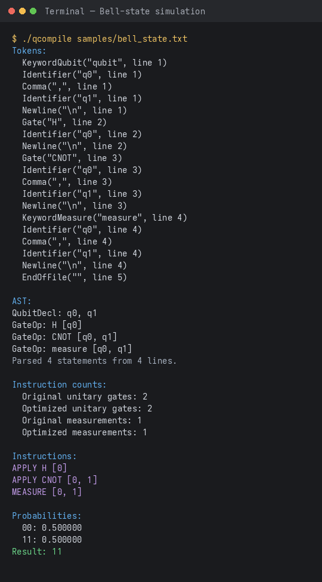
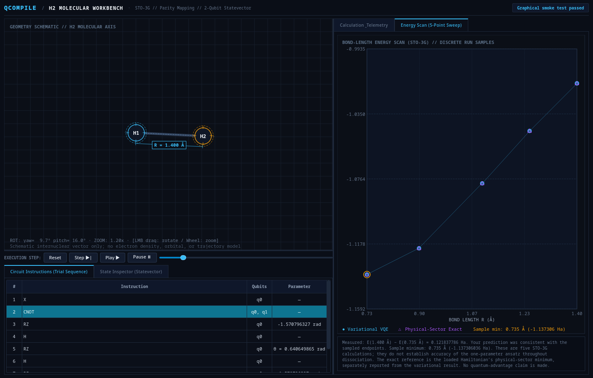

# QCompile

QCompile is a domain-specific language (DSL) compiler and classical statevector simulator for quantum circuits, developed in C++17. It translates high-level quantum circuit definitions into simulator instructions, validates semantics and arithmetic expressions, performs adjacent-gate cancellation optimizations, and simulates state evolution and Pauli expectations on a statevector. It also provides benchmark executables for molecular variational quantum eigensolvers (H₂ and HeH⁺), an interactive Qt6 desktop workbench, and a local loopback dashboard.

---

## Architecture Overview

```text
Source File (.txt)
       │
       ▼
 ┌───────────┐
 │   Lexer   │  Tokenizes keywords, gates, identifiers, literals, operators
 └─────┬─────┘
       │
       ▼
 ┌───────────┐
 │  Parser   │  Constructs AST with recursive-descent arithmetic expressions
 └─────┬─────┘
       │
       ▼
 ┌───────────┐
 │ Semantic  │  Validates qubit declarations, gate arities, unique CNOT pairs,
 │  Checker  │  and statically evaluates parameter expressions
 └─────┬─────┘
       │
       ▼
 ┌───────────┐
 │   Code    │  Emits flat simulator instructions with integer qubit indices
 │ Generator │
 └─────┬─────┘
       │
       ▼
 ┌───────────┐
 │ Optimizer │  Cancels adjacent identical self-inverse gates (H, X, Z, CNOT)
 └─────┬─────┘
       │
       ▼
 ┌───────────┐
 │ Simulator │  Evolves statevector ($2^n$ complex amplitudes), computes Pauli
 └───────────┘  expectations, and samples measurement outcomes
```

### Subsystems and Directory Structure

| Subsystem | Headers | Implementation | Purpose |
| :--- | :--- | :--- | :--- |
| **Compiler** | `include/compiler/` | `src/compiler/` | Lexer, AST parser, semantic checker, code generator, and adjacent-gate optimizer |
| **Simulator** | `include/simulator/` | `src/simulator/` | Statevector simulator, single/two-qubit gates, measurement, and Pauli expectations |
| **Chemistry** | `include/chemistry/` | `src/chemistry/` | Qubit Hamiltonians, Jacobi eigensolver, H₂ VQE, HeH⁺ VQE, and benchmark catalog |
| **GUI** | — | `src/gui/h2_lab.cpp` | Interactive Qt6 desktop workbench for H₂ potential energy surface inspection |
| **Apps** | — | `src/apps/` | Entry points: `qcompile`, `qcompile_h2`, `qcompile_heh`, `qcompile_benchmarks` |

---

## Supported Language Constructs

The QCompile DSL uses line-oriented syntax:

- **Qubit Declarations**: `qubit q0, q1, q2`
- **Variable Declarations**: `let theta = 0.5`, `let phi = 2 * 3.14159 / 4`
- **Unitary Gates**:
  - Fixed: `H <qubit>`, `X <qubit>`, `Z <qubit>`, `CNOT <control>, <target>`
  - Parameterized: `RZ(<expression>) <qubit>`
- **Arithmetic Expressions**: Supports literals, identifiers, unary `-`, binary `+`, `-`, `*`, `/`, and parentheses with standard operator precedence.
- **Measurements**: `measure <qubit> [, <qubit>...]`

Example Bell-state circuit (`samples/bell_state.txt`):
```text
qubit q0, q1
H q0
CNOT q0, q1
measure q0, q1
```

---

## Implementation

The implementation provides command-line compiler/simulator tools alongside visual workbench interfaces:

| Terminal Simulation Output | Interactive Qt6 H₂ Workbench |
| :---: | :---: |
|  |  |
| *Compilation trace, optimization pass, and statevector measurement output for a 2-qubit Bell state.* | *Native Qt6 H₂ workbench displaying potential energy surface scan and statevector inspection.* |

---

## Prerequisites and Build Instructions

### Requirements
- **C++17 Compiler**: `g++` (GCC $\ge$ 9) or `clang++`
- **Build System**: GNU `make`
- **Qt6 Widgets** *(optional, for `qcompile_lab`)*: `qt6-base-dev` and `pkg-config`
- **Node.js** *(optional, for loopback dashboard)*: Node.js $\ge$ 18

### Building

From the repository root:

```bash
# Build compiler, simulator, and benchmark CLIs (qcompile, qcompile_h2, qcompile_heh, qcompile_benchmarks)
make all

# Build the Qt6 workbench (requires Qt6 development libraries)
make qcompile_lab

# Build the regression test suite
make qcompile_tests

# Remove build artifacts
make clean
```

---

## Execution Guide

### 1. Quantum Circuit DSL Compiler
Compile and simulate a DSL circuit:
```bash
./qcompile samples/bell_state.txt
```
Run other provided sample programs:
```bash
./qcompile samples/single_gate.txt
./qcompile samples/sequential_gates.txt
./qcompile samples/three_qubit.txt
./qcompile samples/parameterized_gate.txt
./qcompile samples/precedence_check.txt
```

### 2. Regression Test Suite
Run the modular regression test suite (covers lexer, parser, semantic analyzer, optimizer, simulator, and chemistry validation across 391 assertions):
```bash
make test
# or directly:
./qcompile_tests
```
Test implementations are structured into modular units under `tests/`:
- `tests/test_lexer.cpp`: Comment and tokenization tests
- `tests/test_parser.cpp`: Grammar, precedence, associativity, and AST invariants
- `tests/test_semantics.cpp`: Semantic validation, arity, and numeric safety
- `tests/test_optimizer.cpp`: Cancellation rules and RZ rotation merging
- `tests/test_simulator.cpp`: Statevector evolution, bitstring ordering, and measurement collapse
- `tests/test_chemistry.cpp`: Molecular Hamiltonians, Jacobi eigensolver, and VQE convergence
- `tests/test_support.h` / `test_support.cpp`: Shared test fixtures and assertion helpers

### 3. Molecular Chemistry Benchmarks
Run the fixed molecular benchmarks and catalog CLI:
```bash
# Fixed H2 VQE benchmark (2 qubits, parity mapping, STO-3G at 0.735 Å)
./qcompile_h2

# Fixed HeH+ VQE benchmark (4 qubits, Jordan-Wigner, STO-3G at 1.463283 bohr)
./qcompile_heh

# Benchmark catalog CLI
./qcompile_benchmarks --list
./qcompile_benchmarks h2
./qcompile_benchmarks heh_plus
./qcompile_benchmarks --json-list
./qcompile_benchmarks --json h2
```

### 4. Interactive Qt6 H₂ Workbench
Launch the native graphical workbench:
```bash
./qcompile_lab
```
Run the automated offscreen smoke verification:
```bash
QT_QPA_PLATFORM=offscreen ./qcompile_lab --smoke-test
```

### 5. Loopback Scientific Dashboard
Start the local HTTP dashboard:
```bash
node dashboard/server.js
```
Open `http://127.0.0.1:4173` in a web browser. The server executes allowlisted benchmarks via `qcompile_benchmarks --json <id>` over loopback.

---

## Technical Limitations

- **Statevector Scaling**: The statevector simulator allocates $2^n$ complex amplitudes (`std::complex<double>`). Qubit counts are capped at 24 qubits (~256 MiB amplitude buffer) to prevent memory exhaustion.
- **Measurement Model**: Measurements calculate probabilities and sample basis outcomes using a seeded PRNG (`std::mt19937`); they display outcomes without collapsing the statevector for mid-circuit conditional logic.
- **Gate Set**: Supported unitary operations are restricted to `H`, `X`, `Z`, `CNOT`, and `RZ`. General arbitrary single-qubit rotations or multi-qubit controlled gates require decomposition before input.
- **Optimizer Scope**: The adjacent-gate optimizer performs local pairwise self-inverse cancellations ($H^2=I$, $X^2=I$, $Z^2=I$, $\text{CNOT}^2=I$) on identical adjacent operations. It does not reorder non-commuting gates or synthesize multi-qubit topologies.
- **Chemistry Benchmarks**: Molecular benchmarks evaluate specific frozen models (H₂ in STO-3G with parity reduction; HeH⁺ in STO-3G with Jordan–Wigner) within designated symmetry sectors. They do not constitute an arbitrary quantum chemistry platform.

---

## References and Documentation

For complete technical specifications, language grammar, error catalogs, eigensolver derivations, and chemistry provenance, refer to the [Technical Reference Manual (`DOCUMENTATION.md`)](DOCUMENTATION.md).
