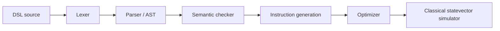

# QCompile

QCompile is a C++17 compiler for a small quantum-circuit DSL, an optimizer and classical statevector simulator, and a molecular-computing workbench. It is intended for education and experimentation with circuit compilation, simulation, and small molecular benchmarks. Circuits run on a classical computer; QCompile does not execute on physical quantum hardware.

## Features

- Lexer tokens retain source locations; a recursive-descent parser builds an AST, including arithmetic expression trees. Semantic checking validates declarations, operands, gate parameters, and expression values before instruction generation.
- Compiler diagnostics include source positions. The circuit optimizer uses a DAG to cancel recognized inverse pairs and merge finite RZ rotations when permitted by supported commutation rules; measurements act as barriers.
- Classical statevector simulation applies H, X, Z, CNOT, and RZ, computes Pauli expectations, and samples/projectively applies measurements using a seeded PRNG. `SimulationSession` supports circuit stepping and state inspection.
- Fixed H₂ and HeH⁺ variational benchmarks, an STO-3G H₂ integral-engine path, and a five-geometry H₂ energy sweep are implemented. The Qt6 workbench combines circuit editing/inspection and stepped execution with molecular calculations, energy/convergence plots, saved experiments, and experiment comparisons.
- Experiment bundles persist circuit and execution data and, where present, chemistry results; comparison entries use bundle IDs where unique and file identity to distinguish saved experiments.
- Automated C++ tests and command-line compiler, H₂, HeH⁺, and benchmark-catalog programs are provided. The GUI also has an offscreen smoke-test mode.

## Implementation gallery


*The repository screenshot shows the workbench’s circuit-execution and molecular-energy interfaces.*


*Captured CLI output for the Bell-state sample.*

## Architecture

The compiler CLI follows this pipeline; the chemistry and GUI components are related consumers of the simulator/compiler facilities, not required stages of every DSL compilation.



- `src/compiler/` and `include/compiler/` implement lexing, AST parsing, semantic validation, instruction generation, diagnostics, circuit DAG optimization, and routing utilities. `src/apps/main.cpp` connects the source-file compiler and simulator.
- `src/simulator/` and `include/simulator/` implement statevector gates, measurement, Pauli expectations, and stepped `SimulationSession` execution.
- `src/chemistry/` and `include/chemistry/` contain Hamiltonians, eigensolvers, molecular integrals, benchmark models, and VQE routines. `src/apps/` provides command-line entry points.
- `src/gui/` implements the Qt6 workbench and circuit view. `src/experiment/` persists and compares experiment bundles; these facilities are also used by the GUI.

## Language guide

Statements are line-oriented. Blank lines are accepted. Qubits and variables must be declared before use:

```text
qubit q0, q1
let theta = 2 * 3.14159 / 4
H q0
CNOT q0, q1
RZ(theta) q1
measure q0, q1
```

This is the same syntax as the supplied Bell-state circuit in `samples/bell_state.txt`, with a variable and parameterized rotation added.

Supported declarations are `qubit name[, name...]` and `let name = expression`. The implemented gates are `H q`, `X q`, and `Z q` (one qubit), `CNOT control, target` (two distinct qubits), and `RZ(expression) q` (one qubit and a required parameter). `measure q[, q...]` measures the named qubits. Gate and measurement operands must refer to declared qubits. Only RZ accepts a parameter; the parser’s broader optional-parentheses syntax is rejected by semantic validation for other operations.

Expressions support integer/decimal literals, previously declared variables, unary minus, parentheses, and `+`, `-`, `*`, `/`. Multiplication and division bind more tightly than addition and subtraction. Invalid tokens and grammar produce source-located lexer/parser diagnostics; semantic errors include undeclared names, invalid gate arity/operands, duplicate or invalid declarations, and invalid parameter expressions. There is no control-flow syntax.

## Build and installation

Requirements: a C++17 compiler (the Makefile defaults to `g++`), GNU `make`, and a POSIX-like environment for the Makefile’s symlink commands. Building the GUI additionally requires Qt6 Widgets development files and `pkg-config` (the Makefile invokes `pkg-config Qt6Widgets`). The Makefile does not enforce a specific compiler version.

```sh
make all           # qcompile, qcompile_h2, qcompile_heh, qcompile_benchmarks
make qcompile_tests
make qcompile_lab  # requires Qt6 Widgets
```

Executables are linked at the repository root and built under `build/<configuration>/bin/`. Use `BUILD=debug` for a debug build; release is the default. `make test` builds and runs the test executable. `make clean` removes generated build artifacts and binaries.

## Usage

Build the command-line tools before using the following commands:

```sh
./qcompile samples/bell_state.txt
```

Compiles and simulates the supplied Bell-state program, printing token/AST/instruction information and measurement probabilities/result.

```sh
make test
```

Builds and runs the C++ regression suite.

```sh
./qcompile_h2
./qcompile_heh
```

Run the fixed H₂ and HeH⁺ variational benchmarks respectively; each prints its benchmark calculation and energy results.

```sh
./qcompile_benchmarks --list
./qcompile_benchmarks h2
./qcompile_benchmarks heh_plus
```

Lists the catalog or runs a catalog benchmark. For H₂ integral-engine calculations at selected distances in ångströms, use `./qcompile_benchmarks --engine-h2 0.735`; `--engine-lih` is another implemented benchmark option.

```sh
make qcompile_lab
./qcompile_lab
```

Launches the Qt6 GUI. The Quantum Circuit Workbench lets you enter DSL source, inspect the generated circuit, step execution, and view statevector data. The Molecular PES Laboratory provides H₂ calculations and energy/convergence plots. The Comparison Inspector loads `.qcomp` experiment bundles; load at least two bundles to compare properties and reported deltas. Save experiments from the workbench before adding them in the comparison view.

For a non-interactive GUI smoke check where Qt’s offscreen platform plugin is available:

```sh
QT_QPA_PLATFORM=offscreen ./qcompile_lab --smoke-test
```

The smoke test exercises workbench calculations and GUI workflows without requiring a visible desktop window.

## Chemistry and numerical methods

The fixed H₂ and HeH⁺ models use STO-3G benchmark data. The code constructs qubit Hamiltonians and evaluates variational trial circuits with the classical simulator; symmetric eigensolver routines provide reference ground-state energies for the implemented sectors. H₂’s optimizer searches a one-parameter trial family; HeH⁺ uses a two-parameter singlet trial family and a multi-start coordinate/golden-section search. These are small benchmark-specific optimizations, not general-purpose chemistry or quantum optimizers.

The GUI’s H₂ geometry sweep evaluates five discrete distances (0.735, 0.900, 1.100, 1.250, and 1.400 Å in the current smoke-tested workflow). At each geometry, the STO-3G calculation reports variational electronic energy and adds the nuclear-repulsion contribution to obtain total Born–Oppenheimer energy:

`E_total = E_electronic + E_nuclear-repulsion`.

The plotted molecular potential energy is the total energy, not the electronic term alone. Electronic and nuclear-repulsion terms are also shown separately in calculation results. The five samples are a coarse demonstration sweep; they do not establish a high-resolution or universally validated potential-energy curve. `benchmarks/h2_geometry/` contains related generation and validation utilities.

## Testing and verification

The current test target is `qcompile_tests`, run with `make test`. Running the repository’s existing test executable produced **1586 passing assertions**. The test sources cover compiler stages, optimizer, simulator/session, chemistry and molecular integrals, VQE optimization, experiment bundles, and workbench integration.

The Qt GUI smoke test was run as `QT_QPA_PLATFORM=offscreen ./qcompile_lab --smoke-test`; it reported success after testing two distinct geometries and five fresh sweep calculations. This is GUI smoke coverage, not exhaustive interactive/manual testing. Fixed benchmark programs are separate benchmark runs and are not substitutes for the automated suite.

## Repository map

```text
include/       Public headers grouped by compiler, simulator, chemistry, GUI, experiment
src/           C++ implementation: apps, compiler, simulator, chemistry, GUI, experiment
tests/         Automated C++ test suite and shared test support
samples/       DSL examples and invalid-input examples
benchmarks/    Molecular reference data, generation, and validation utilities
dashboard/     Optional local web dashboard (Node.js)
docs/          Reports and repository screenshots
Makefile       Build, test, and clean targets
README.md      Getting-started guide
DOCUMENTATION.md  Detailed technical reference
```

## Limitations

- Statevector storage scales as $2^n$ complex amplitudes. The simulator’s configured upper bound is 24 qubits (about 256 MiB for amplitudes alone); execution sessions also retain intermediate states and have an additional memory budget.
- The DSL is a small line-oriented language without control flow, general gate decomposition, or arbitrary gate definitions. Its unitary set is H, X, Z, CNOT, and RZ.
- Measurement samples a computational-basis outcome with a fixed-seed PRNG and projects the state to the observed outcome. It is a single-shot classical simulation behavior, not hardware sampling or noise modeling.
- The simulator is a classical statevector implementation. QCompile has no direct physical-hardware backend. Molecular models and geometry support are limited to the implemented benchmark paths, not an arbitrary quantum-chemistry package.

## Further documentation

- [Technical reference manual](DOCUMENTATION.md)
- [Compiler source](src/compiler/), [simulator source](src/simulator/), [chemistry source](src/chemistry/), and [GUI source](src/gui/)
- [Samples](samples/), [benchmark materials](benchmarks/), and [validation report](docs/MS10_FINAL_REPORT.md)
- [QCompile GitHub repository](https://github.com/TodScissorhands/QCompile)
